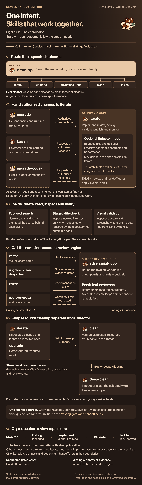
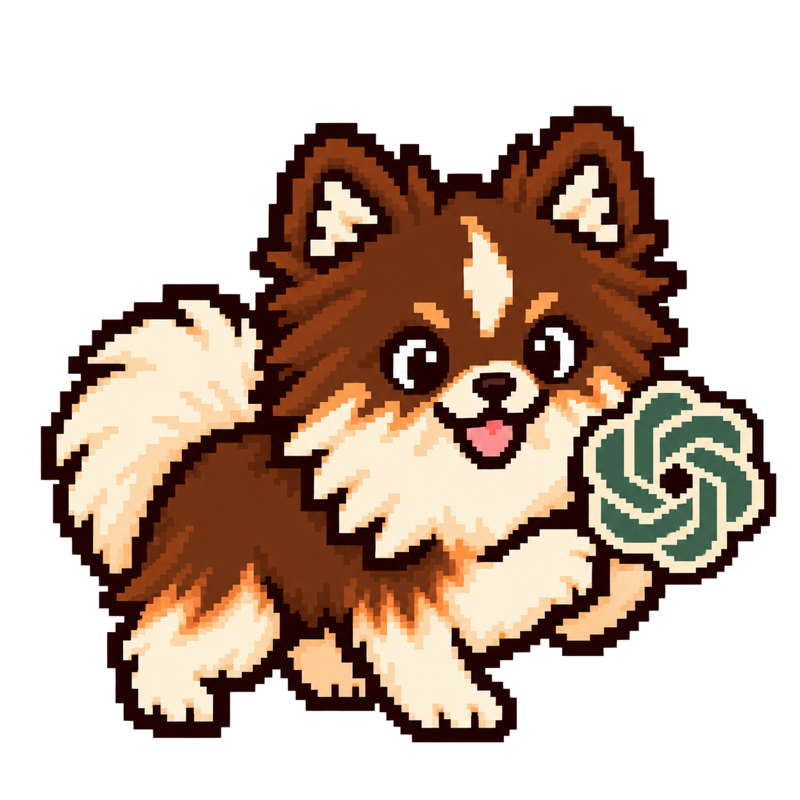
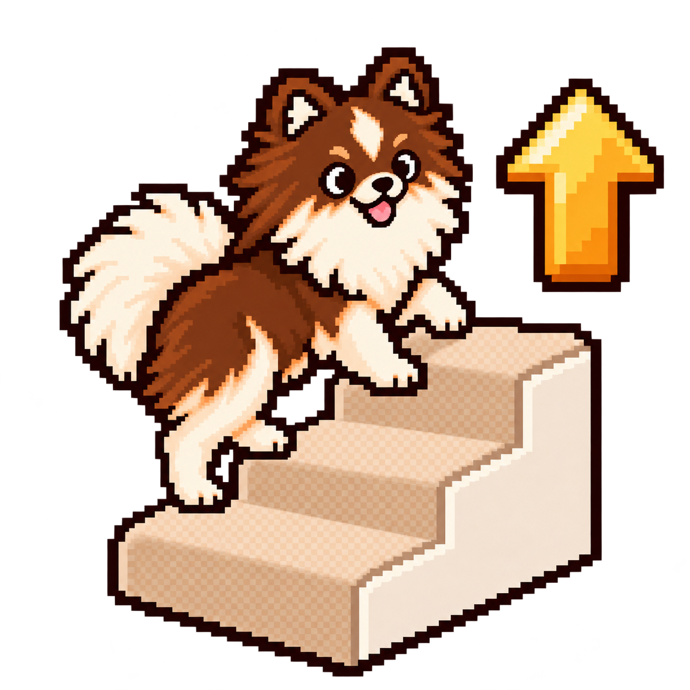
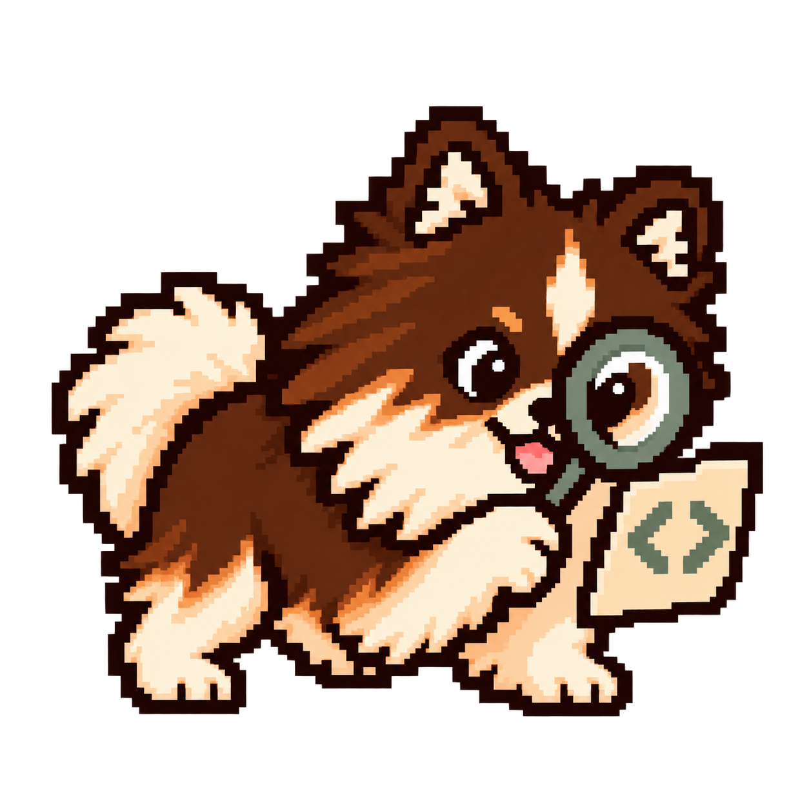
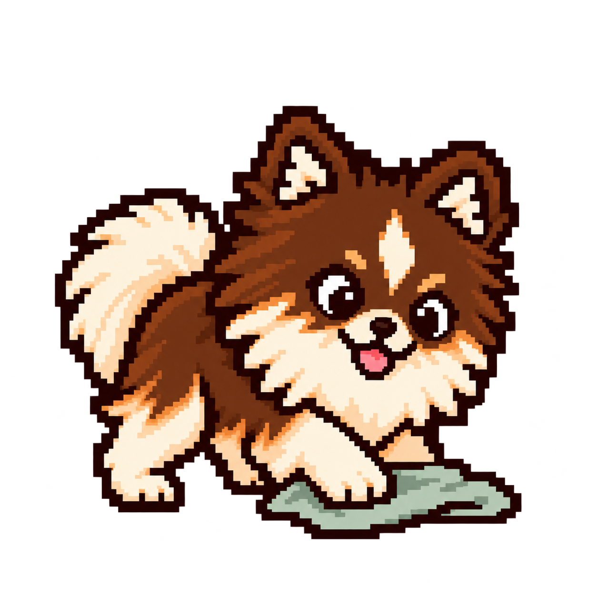
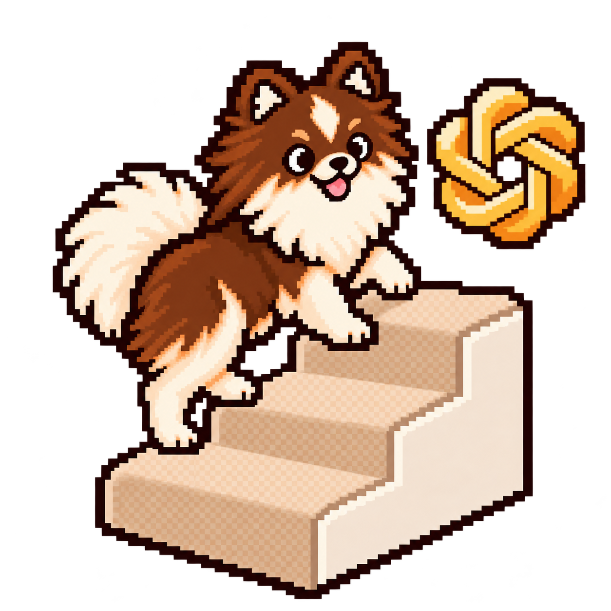

# Develop

Eight portable skills for scoped development, review and maintenance. [Install in Codex](INSTALL.md), then invoke `$develop:develop` with the outcome you want, or call the owning skill directly. Develop carries authorized work through the requested checks and handoff, preserving narrow review or diagnosis requests. No external workflow plugin is required.

Open the image for the full-size guide. The [HTML overview source](docs/develop-overview.html) and optional [interactive explorer](docs/develop-route-explorer.html) explain the same workflow. These are instructions followed by an agent; native-host execution needs separate verification.

## Choose a skill

| Icon | Skill | Use it for |
| --- | --- | --- |
|  | [develop](skills/develop/SKILL.md) | Route an outcome to its owner and keep one coordinator across handoffs. |
|  | [iterate](skills/iterate/SKILL.md) | Implement, refactor, review, diagnose incidents, publish, monitor CI/reviews and prepare deployment handoffs. |
|  | [upgrade](skills/upgrade/SKILL.md) | Assess dependencies and runtimes and plan migrations; hand authorized implementation to Iterate. |
|  | [adversarial-loop](skills/adversarial-loop/SKILL.md) | Independently review facts, visuals, writing, plans and results with bounded fresh review rounds and optional user rubrics. |
|  | [clean](skills/clean/SKILL.md) | Inspect or remove verified disposable artifacts/processes attributable to this thread. |
|  | [deep-clean](skills/deep-clean/SKILL.md) | Inspect or clean explicitly widened filesystem scope using Clean's protections. |
|  | [kaizen](skills/kaizen/SKILL.md) | Learn from selected sessions and recommend workflow improvements; use Iterate for requested implementation. |
|  | [upgrade-codex](skills/upgrade-codex/SKILL.md) | Explicitly audit selected Codex configuration against the installed or specified version; report coverage gaps and required versus optional changes. |

## How work moves

These are conditional handoffs, not a sequence every task runs. Composed work returns through the [shared handoff](skills/develop/references/contract.md#handoffs); standalone calls keep their owner's completion policy.

| Owner | Handoff and boundary |
| --- | --- |
| Develop | Selects the requested outcome's owner. Deep-clean needs explicit scope or invocation; upgrade-codex always needs explicit invocation. Generic dependency upgrades stay with Upgrade. |
| Iterate | Runs intent/evidence checkpoints through adversarial-loop, reusing current nested gates. Calls Clean only for requested cleanup or an identified authorized resource need. |
| Upgrade | Reviews assessment and final evidence through shared gates. Calls Iterate for authorized implementation/delivery, then combines its evidence with the dependency ledger. Clean is conditional on an authorized resource need. |
| upgrade-codex | Starts with an audit; audit review is opt-in. Requested changes use Iterate and shared gates, returning evidence to the Codex coverage report. Client installation is separate. |
| Kaizen | Reviews selected-session recommendations through adversarial-loop. Only specifically authorized improvements go to Iterate; tested outcomes return within the selected scope. |
| Clean / Deep-clean | Review targets and outcomes. Explicitly widened scope can pass to Deep-clean, which reuses Clean's execution/protections without restarting it. Return coverage, measurements and protected/blocked dispositions. |
| adversarial-loop | Fresh independent reviewers return findings to the coordinator. Reviewers never start nested reviews or acquire implementation authority. |

Upgrade assesses dependencies before implementation. The user may explicitly bypass the separate assessment after planning; factual prerequisites, validation and protections still apply. Handoffs preserve scope, authority and review budgets, with one delivery owner, review engine and watcher. CI-only requests do not start Codex reviews; publication does not authorize deployment or merging.

## Iterate tools and guidance

- [Staged-file size check](skills/iterate/references/staged-file-size.md): an explicitly invoked, offline, read-only Python 3.10+ and Git helper, with optional repository-owned profiles and inert hook examples. It never edits or stages files, discovers profiles or installs hooks; repositories may retain a reviewed standalone copy.
- [Focused source reading](skills/iterate/references/documentation.md#focused-source-reading): narrow paths and searches before reading large documents or corpora, while preserving necessary context and reporting coverage gaps.
- [Visual validation](skills/iterate/references/visual-validation.md): inspect actual structure and screenshots, exercise changed interactions, and report the surfaces and states verified.
- [Refactoring](skills/iterate/references/refactoring.md): an Iterate mode with bounded objectives, preserved behavior/performance and acceptance checks. A focused worker returns its diff/evidence; the coordinator integrates, runs applicable full tests and reviews the result.
- [GitHub monitoring](skills/iterate/references/github-monitoring.md): the bundled watcher tracks CI. Its vendor-specific review adapter is explicit; other required reviews use native evidence. Passing CI alone does not certify all PR approvals.

Scope stays with selected repositories and sessions. Clean defaults to this thread; deep inventories require installed Python 3.10+ and do not imply removal eligibility. Both cleanup skills preserve retained plugin state, memories, secrets and useful/shared work. Signing is nonblocking: prefer an existing noninteractive signer, otherwise fall back unsigned while preserving the thread's preference and actual server restrictions.

Develop uses the [Apache-2.0 license](LICENSE). Maintainers should follow [package, release and artwork instructions](AGENTS.md).
